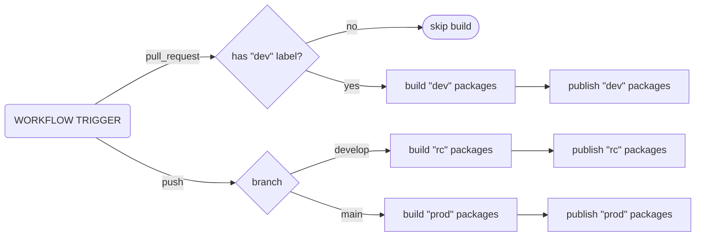

# Contributing

This project is open to everyone. Feel free to test the library, share it, improve it, and create pull requests.

## Getting started

### Tools

#### [nvm](https://github.com/nvm-sh/nvm)

We recommend using [nvm](https://github.com/nvm-sh/nvm) to manage your Node.js versions.

```shell
curl -o- https://raw.githubusercontent.com/nvm-sh/nvm/v0.40.3/install.sh | bash
```

#### [Node](https://nodejs.org)

```shell
nvm use

# Verify the Node.js version:
node -v
```

#### [Yarn](https://yarnpkg.com)

```shell
corepack enable yarn

# Verify Yarn version:
yarn -v

# Install the dependencies:
yarn install
```

### Code

- The source code is located in the `src` directory.
- The project uses [prettier](https://prettier.io/) to format the code. You'll want to enable and configure it in your IDE.
- The tests run with [vitest](https://vitest.dev)

### Commands

- `fb:build`: builds the library.
  - converts the TypeScript files into JavaScript files, copies the SCSS files, and assembles all the assets to create a package ready to be published.
  - some files are handled differently:
    - `*.protected.{ts,scss}` or `**/*.protected/**`: these files are exported under `package-name/protected`.
      - this is intended to expose parts of the code that should be restricted to advanced users only, or shared with other libraries requiring _internal_ control.
    - `*.private.{ts,scss}` or `/*.private/**`: these files are **not** exported.
      - this is intended to consume parts of the code internally, without exposing them publicly.
- `fb:format`: formats the code using `prettier`.

### To create a PR

1. Fork the repository
1. Add the feature or fix by modifying the code in the `src/` directory
1. Add/write some tests with good code coverage (run them with `yarn fb:test:coverage`)
1. Format the code using the command `yarn fb:format`
1. Commit and push your work following the [Conventional Commits](https://www.conventionalcommits.org/en/v1.0.0/) convention
1. Create a PR from your fork to the upstream repository, clearly explaining what was added or fixed.

## Release Workflow

> The `release.yml` workflow runs on `pull_request` and `push` events for the `main` and `develop` branches.
> It invokes `yarn fb:ci:release`, which builds and publishes the packages.
> Note that the `publish` step runs only if the equivalent stable version (`x.y.z`) does not already exist on npm.

### 1. Pull Request to `main` or `develop`

- The `dev` label is added to the PR
- Impacted packages are published as: `x.y.z-dev.<timestamp>`
- npm dist-tag: `dev`

> Use the `dev` versions only if required.

> [!NOTE]
> The PR is published only if it carries the `dev` label — add it to the PR to get a `dev` release; otherwise the release is skipped.
> Pull requests coming from forks always run in dry-run mode: nothing is published.

### 2. Push to `develop`

- Impacted packages are published as: `x.y.z-rc.<timestamp>`
- npm dist-tag: `rc`

### 3. Push to `main`

- Stable publication: `x.y.z`
- npm dist-tag: `latest`

### Graph



## Important Rules

- If an equivalent **stable** version already exists on npm, the release fails — bump the `package.json#version` before releasing (this also blocks `dev` / `rc` releases of a stable version that was already published).
- The `package.json` version in the repo must always be a stable version (`x.y.z`).
- The `-dev` / `-rc` suffixes are generated in CI.
- The npm publish authenticates with [GitHub Actions OIDC](https://docs.github.com/en/actions/security-for-github-actions/security-hardening-your-deployments/about-security-hardening-with-oidc): no `NPM_TOKEN` secret is required (the `release.yml` workflow requests the `id-token: write` permission).
